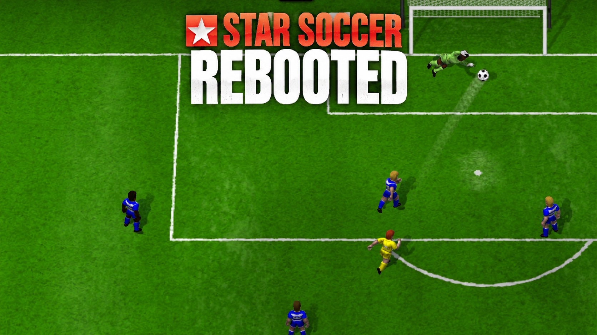
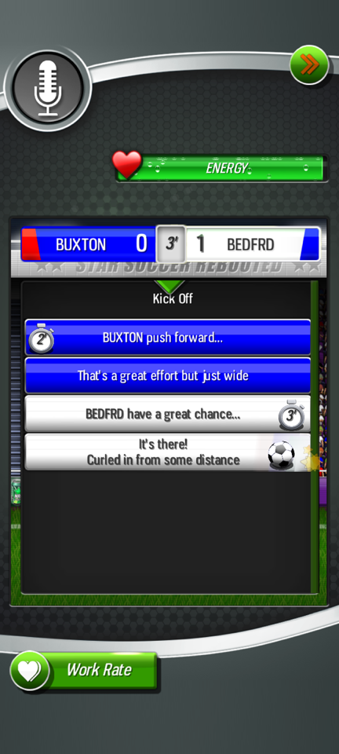
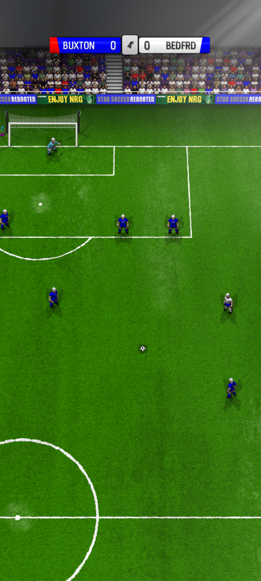
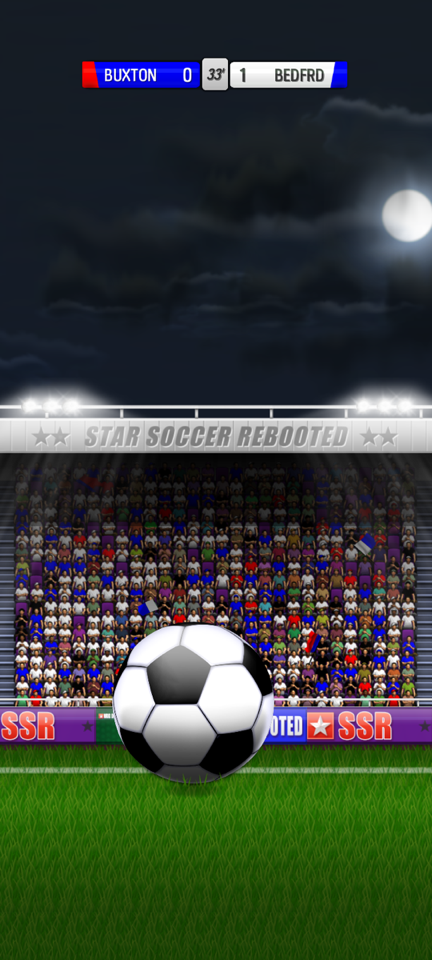
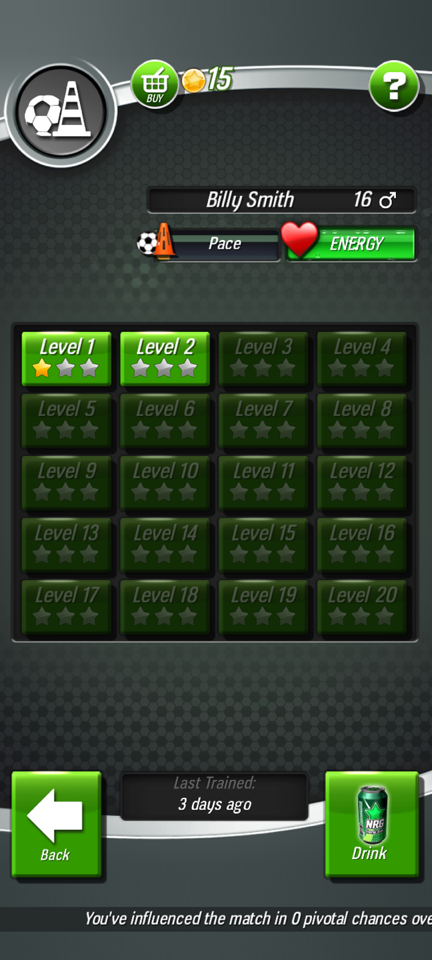
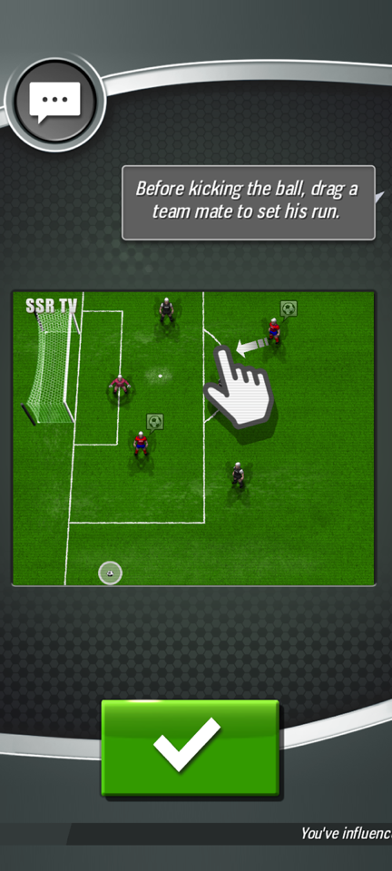
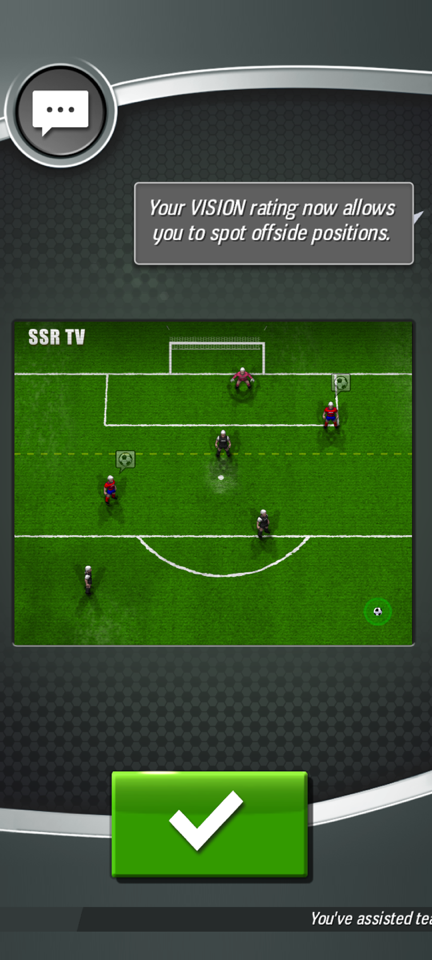

### A remake of New Star Soccer 4.32 with a living world

_Native C and SDL3, the career of 4.32, your own copy of the game_

  <a href="#overview"><b>Overview</b></a> |
  <a href="#you-need-a-copy-of-new-star-soccer"><b>Your copy</b></a> |
  <a href="#install"><b>Install</b></a> |
  <a href="#build"><b>Build</b></a> |
  <a href="docs/decisions.md"><b>Decisions</b></a> |
  <a href="TODO.md"><b>Roadmap</b></a>

---

> [!NOTE]
> **Version 1.0 is out.** It has all the content of New Star Soccer 4.32 in
> the new look: the career, the matches, the training of the skills and the
> practice, the life of the player, the side games, and the retirement.
> [CHANGELOG.md](CHANGELOG.md) lists the changes of each release.
> [docs/decisions.md](docs/decisions.md) holds each decision and its reason.

> [!IMPORTANT]
> This is a fan project. It is not from New Star Games. The repository and
> the releases hold no file of New Star Soccer. You need your own copy.

---

<table>
<tr>
<td width="33%" valign="top">

<i>A match</i>

</td>
<td width="33%" valign="top">

<i>A chance on the pitch</i>

</td>
<td width="33%" valign="top">

<i>The tap ball</i>

</td>
</tr>
<tr>
<td width="33%" valign="top">

<i>The training of a skill</i>

</td>
<td width="33%" valign="top">

<i>The tutorial of the captain</i>

</td>
<td width="33%" valign="top">

<i>The tutorial of the offside rule</i>

</td>
</tr>
</table>

## Overview

**Star Soccer Rebooted** plays the career of
[New Star Soccer](https://www.newstargames.com/) 4.32 on iOS, Android, and
macOS. It is a new engine in C99 with SDL3. It runs the screens of the game
from the layout files of your copy, and it reads the art, the sounds, the
fonts, and the text from your copy. It holds no file of New Star Soccer.

The rules come from the code of the Android release 4.32.
`scripts/rules-check.sh` runs that code on an Android device and compares
it with the remake.

The remake adds a living world. In 4.32 the player is the only player with
a career. In the remake, the other players and the managers have careers,
the news tells their stories, and the honours keep the records of each
league, club, and nation.

## Features

- The full career of 4.32: the trials, the matches and the chances, the
  league, the cups, and the continental competitions, the international
  matches, transfers and contracts, and the retirement
- The training of the skills: the 20 levels of the drill of each skill,
  with their stars, and the practice with its record and prizes
- The life of the player: relationships, dilemmas, interviews, the shop,
  boots, energy drinks, the agent and the trainer, and the 108 awards
- The side games: blackjack, roulette, slots, and the horses with the
  stable and the races
- A living world: other players and managers with careers, rivals, the
  news, derbies and rivalries, and the honours, the records, and the hall
  of fame
- Four positions, each with its mix of moments: goalkeeper, defender,
  midfielder, and forward
- Real ratings and scores, or the classic ones of 4.32
- Weather, snow in the winter, and big matches in full stadiums
- A custom career: the age, the skills, the position, the first club, and
  the Bux
- Data packs with real leagues, squads, stadiums, and crests, an editor in
  the app, and a browser of the packs on the desktop
- All the languages of 4.32

## You need a copy of New Star Soccer

The art, the sounds, the fonts, and the text of New Star Soccer belong to
New Star Games. The app reads them from your copy. New Star Soccer is free
on Google Play and on the App Store.

The app accepts these files:

- an APK, for example from `adb pull` on your Android phone. On Android
  the app imports the game that is installed on the phone.
- an XAPK, an APKM of APKMirror, or an APKS, which holds the APK
- an IPA that you decrypted from your own install

The reference version is the Android release 4.32.

## Install

Download the files from the
[latest release](https://github.com/Stiven-Gjekaj/StarSoccerRebooted/releases/latest).

**iOS.** Add the source
`https://stiven-gjekaj.github.io/sidestore-source/apps.json` to SideStore
or AltStore, or install `StarSoccerRebooted.ipa` with them. Start the app
one time. Then put your copy in the folder of the app: in Files, open On My
iPhone and then Star Soccer. In LiveContainer, use the Documents folder of
the container of the app. Close the app fully and start it again. It
imports the first XAPK, APKM, APKS, APK, or IPA of the folder.

**Android.** Install New Star Soccer from Google Play first. Then install
the APK of the release. The app imports the game from the phone.

**macOS.** Unzip the file and move the app to Applications. The app is not
signed. The first time, right-click the app and choose Open. Then drop your
copy on the window.

A data pack is a zip file. On iOS, put it in the same folder as your copy.
On the desktop, drop it on the window, or use Options, Packs.

## Build

You need CMake. The build gets SDL3 3.4.18 and builds it from its source.
On macOS:

    brew install cmake
    cmake -S . -B build
    cmake --build build

| Command | Result |
| ------- | ------ |
| `scripts/test.sh` | Builds the app and runs the tests |
| `scripts/ipa.sh` | An unsigned `build/StarSoccerRebooted.ipa` for iOS |
| `scripts/screen-diff.sh` | Compares one screen with a screenshot of the original |
| `scripts/rules-check.sh` | Compares the rules with the code of 4.32 on an Android device |
| `scripts/release.sh` | Tests, builds the apps, tags, and publishes a release |

For Android, open `android/` in Android Studio, or run
`./gradlew assembleDebug` in it. For the iOS simulator, make an Xcode
project with `cmake -S . -B build/ios -G Xcode -DCMAKE_SYSTEM_NAME=iOS
-DCMAKE_OSX_SYSROOT=iphonesimulator -DCMAKE_OSX_DEPLOYMENT_TARGET=15.0`.

The tests build the archives that they need. They do not read a copy of
the game. `scripts/rules-check.sh` runs the code of 4.32 with `dalvikvm` on
a device that has the game. The cases are in `tools/rules/RulesProbe.java`
and `tools/rules/rulecheck.c`. A new case goes into both files.

## Run

Give the app the path of your copy:

    "./build/Star Soccer Rebooted.app/Contents/MacOS/Star Soccer Rebooted" path/to/NewStarSoccer.xapk

You can also drop the file on the window. The app copies the assets into
its data directory. On macOS this is
`~/Library/Application Support/StivenGjekaj/StarSoccerRebooted/game`.
After the first import, start the app with no path.

These variables help to test a build:

| Variable | Result |
| -------- | ------ |
| `SSR_SHOT=frame.png` | Saves the first frame as a PNG and quits |
| `SSR_SHOT_MS=3000` | Saves the frame 3 seconds later |
| `SSR_SCREEN=options.uis` | Shows another screen of the game |
| `SSR_PRESS=500,540` | Presses a point of the screen after 1.5 seconds |

## Support

If you find Star Soccer Rebooted useful, you can support its development
here.

## Licence

The code is under the MIT licence. See [LICENSE](LICENSE). New Star Soccer
and its art, sounds, fonts, and text belong to New Star Games.
